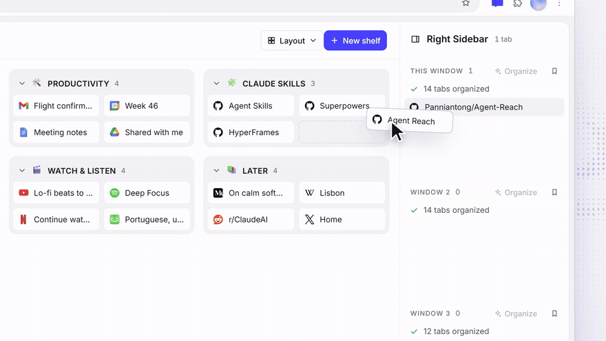

<div align="center">


# Shelf

**Close every tab. Lose none of them.**

A calm new tab page for Chrome and Firefox: save your tabs into spaces and shelves,<br>
find anything with <kbd>Alt</kbd> + <kbd>K</kbd>, and reopen a tab or a whole shelf later.

<a href="https://chromewebstore.google.com/detail/shelf/dlniihehmagppkhmgmidkldccopbonhi"></a>
<a href="https://addons.mozilla.org/firefox/addon/shelftabs/"></a>

<a href="https://autoshelf.site"></a>
<a href="LICENSE"></a>


<br><br>

<a href="https://autoshelf.site/media/shelf.mp4"></a>

<sub>▶ <a href="https://autoshelf.site/media/shelf.mp4">Watch the one-minute film</a> · <a href="https://autoshelf.site">autoshelf.site</a></sub>

</div>

---

## What it does

|   |   |
|---|---|
| 🗂️ **Spaces and shelves** | Group saved tabs by project. Drag tabs in from the Open tabs panel, reorder anything, fold what's done. |
| 💾 **One-click save** | Save a whole window as a shelf, or one tab from the right-click menu. |
| 🔎 **Search everything** | <kbd>Alt</kbd> + <kbd>K</kbd> finds any saved tab, note or shelf as you type. |
| 📝 **Notes and colours** | Pin a note to a shelf, give it a colour, star the ones you use most. |
| 🌗 **Light and dark** | Follows your system, or pick one. |
| 🧭 **Side panel** | The same board in Chrome's side panel and Firefox's sidebar. |
| 📦 **Your data, portable** | Export and import everything as a plain JSON file. |

## This repository and the store version

This is the open-source build of Shelf. It has everything above and runs fully on your own machine. The versions on the Chrome Web Store and Firefox Add-ons add a few things on top:

| | Open-source build | [Chrome](https://chromewebstore.google.com/detail/shelf/dlniihehmagppkhmgmidkldccopbonhi) / [Firefox](https://addons.mozilla.org/firefox/addon/shelftabs/) store version |
|---|:---:|:---:|
| Spaces, shelves, notes, search, side panel | ✅ | ✅ |
| Spaces | Up to 3 | Unlimited |
| Organize: sort every open tab into shelves in one click | — | ✅ |
| Sync across browsers, shared spaces | — | ✅ |

Sign-in only works from the official store builds, so a copy you load yourself works without an account.

## Privacy, in the code

- **No analytics, no tracking, no ads.**
- **Without an account, nothing leaves your browser.** The extension's security policy in [`manifest.json`](manifest.json) allows network access to only two addresses: the sign-in service and Shelf's API.
- **Shared spaces are end-to-end encrypted** in your browser (AES-256-GCM, [`lib/crypto.js`](lib/crypto.js)) before they're uploaded, so the server can't read them.
- **Synced spaces are encrypted at rest** by the server, which holds that key, so they are not end-to-end encrypted. The [privacy policy](https://autoshelf.site/privacy.html) explains both.

## Run it from source

You need Node 20 or later. There are no dependencies to install.

```bash
npm test
```

**Chrome, Edge, Brave or Vivaldi**

1. Open `chrome://extensions`.
2. Turn on **Developer mode**.
3. Click **Load unpacked** and choose this folder.

**Firefox 140+**

```bash
npm run build -- --allow-placeholders
```

Then open `about:debugging`, choose **This Firefox → Load Temporary Add-on**, and pick `dist/firefox/manifest.json`.

## Project layout

| Path | What it is |
|---|---|
| `newtab.html`, `newtab.js` | The dashboard on every new tab |
| `sidepanel.html`, `sidepanel.js` | The side panel (Chrome) and sidebar (Firefox) |
| `background.js` | Right-click menu, toolbar button, sync timer |
| `lib/store.js` | Data model, validation and every edit, behind a shared lock |
| `lib/crypto.js`, `lib/sync.js` | End-to-end encrypted shared spaces |
| `lib/auth.js` | Sign-in (OAuth with PKCE) |
| `lib/motion.js` | Animation helpers; respects reduced motion |
| `styles/theme.css` | Every colour, size and easing curve, in one place |
| `scripts/build.mjs` | Builds the Chrome and Firefox packages |
| `tests/` | `node --test` suites for the data model and accounts |

## Contributing

Issues and pull requests are welcome. See [CONTRIBUTING.md](CONTRIBUTING.md). To report a security problem privately, see [SECURITY.md](SECURITY.md).

## Licence

The code is licensed under the [GNU General Public License v3.0 or later](LICENSE). You may use, change and share it. If you publish a changed version, it must stay under the same licence with its source available.

The name "Shelf", the Shelf logo and the store listings are not covered by the licence. If you publish your own version, give it a different name and icon.

Inter is by Rasmus Andersson, under the SIL Open Font License (`fonts/Inter-LICENSE.txt`).

<div align="center">
<br>
<a href="https://autoshelf.site"></a><br>
<sub><a href="https://autoshelf.site">autoshelf.site</a></sub>
</div>
